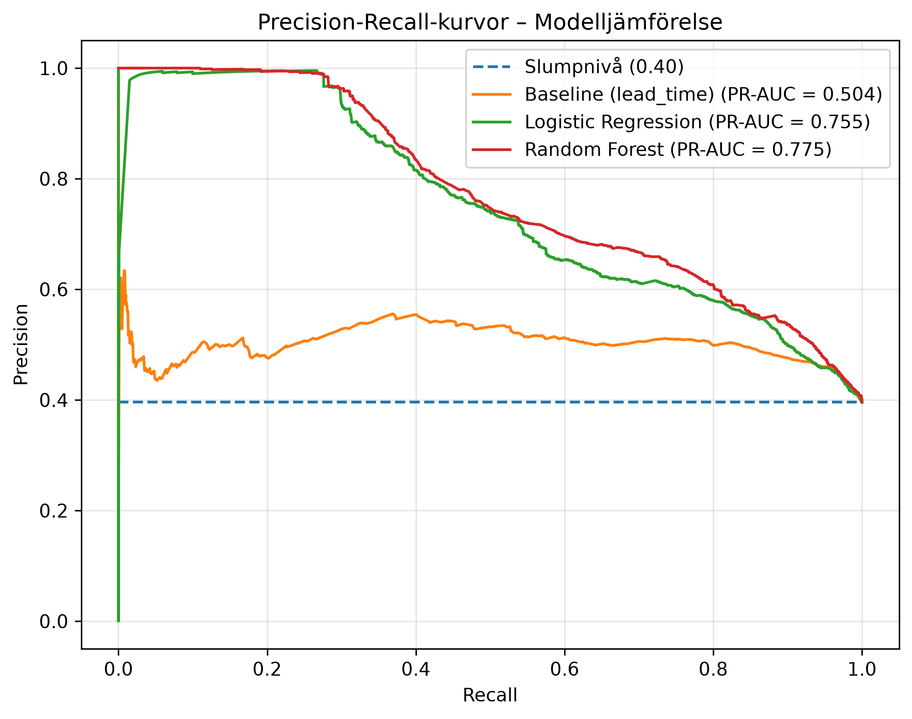

# Hotel Booking Demand - ML Project

## 1. Projektets problem och syfte

Avbokningar gör att hotellrum står tomma. Hotell överbokar därför, men överbokar de för mycket får gäster inget rum.  
Syftet är att undersöka om det går att förutsäga vilka bokningar som kommer att avbokas, utifrån uppgifter om bokningen och gästen. 

## 2. Tänkt användare eller målgrupp

Intäkts- eller bokningsansvarig på ett hotell, som vill veta hur många bokningar som sannolikt avbokas  för att planera eventuell överbokning eller vilka gäster det kan löna sig att kontakta, till exempel med en påminnelse eller ett erbjudande om att bekräfta. 

## 3. Gruppmedlemmar

- Malin Moisander 
- Shara Hysen 
- Josefin Oleryd 
- Alma Vasell 
- Jack Olofsson 

## 4. Datakälla

**Källa och ansvar.** Datan publicerades av Nuno Antonio, Ana de Almeida och Luis Nunes (ISCTE-IUL) tillsammans med artikeln, och hämtas från Kaggle (`jessemostipak/hotel-booking-demand`), där artikelns två filer är sammanslagna till en.

**Användningsvillkor.** CC BY 4.0: datan får användas och delas om källan anges.

**Hämtning.** Datan hämtas automatiskt med kagglehub när `python -m src.data_cleaning` körs. Den hämtades första gången 1 oktober 2026.

**Begränsningar.**
- Bara två hotell i Portugal, ett semesterhotell och ett stadshotell, under 2015–2017, så resultaten kan inte direkt överföras till andra hotell eller perioder.
- Värdena visar bokningen dagen före ankomst, inte vid bokningstillfället, och ändringshistoriken saknas.
- Boknings-ID saknas, så identiska rader går inte att skilja åt.
- Ej återbetalningsbara bokningar beter sig som gruppblock från resebyråer och avbokas i 99 % av fallen.

**Hur datan ser ut.** 119 390 bokningar med ankomst juli 2015 – augusti 2017, 32 kolumner och målvariabeln is_canceled (avbokad eller inte).  
Variablerna beskriver:  
- Bokningen: dagar mellan bokning och ankomst, ankomstdatum, antal nätter, rumstyp, pris per natt, depositionstyp 
- Gästen: antal vuxna och barn, land, kundtyp, återkommande gäst, tidigare avbokningar 
- Kanal: marknadssegment, distributionskanal, resebyrå eller företag 
- Önskemål: specialönskemål, parkeringsplats, måltider 

## 5. Projektstruktur

```
data-science-group-project/
├── data/
│   └── processed/                           # Städad data, skapas med python -m src.data_cleaning (finns inte i Git)
├── docs/
│   └── motesprotokoll/                      # Mötesanteckningar från gruppens avstämningar
├── notebooks/
│   ├── 01_eda.ipynb                         # Explorativ dataanalys och motivering av städning och uppdelning
│   ├── 02_demonstration.ipynb               # Slutlig utvärdering på testdatan och felanalys
│   ├── 03_baseline.ipynb                    # Baseline: rangordning efter lead_time
│   ├── 04_logistic_regression_demo.ipynb    # Logistisk regression på valideringsdatan
│   └── 05_random_forest.ipynb               # Random Forest, val av inställningar och kontrollanalyser
├── outputs/
│   ├── figures/                             # Sparade figurer
│   └── experiment_results.csv               # Logg över modellkörningar
├── src/
│   ├── config.py                            # Gemensam konfiguration och loggning
│   ├── data_loader.py                       # Hämtar rådata via kagglehub
│   ├── data_cleaning.py                     # Städning och validering av data (Pandera)
│   ├── data_split.py                        # Kronologisk uppdelning i träning, validering och test
│   ├── preprocessing.py                     # Val av features, kodning och skalning
│   ├── logistic_regression.py               # Träning av logistisk regression
│   ├── random_forest.py                     # Träning av Random Forest och feature importance
│   ├── prediction.py                        # Gemensamma funktioner för förutsägelser
│   ├── evaluation.py                        # Utvärdering vid 20 % flaggade, PR- och ROC-kurvor, förväxlingsmatriser
│   └── experiment_logger.py                 # Loggning av körningar och sparande av figurer
├── tests/                                   # Automatiska tester för modulerna i src/ (körs med pytest -v)
├── pytest.ini
├── requirements.txt
└── README.md
```

Logiken ligger i `src/`, och notebookarna anropar funktionerna där. Flödet är:

`data_loader` → `data_cleaning` → `data_split` → `preprocessing` → modell → `evaluation`

## 6. Installation

1. Klona repot och gå in i mappen:
   `git clone <url>`
   `cd data-science-group-project`

2. Skapa och aktivera virtuell miljö:
   `python -m venv .venv`
   `.venv\Scripts\activate` (Windows, kommandotolken), `source .venv/Scripts/activate` (Windows, Git Bash) eller `source .venv/bin/activate` (Mac/Linux)

3. Installera beroenden:
   `pip install -r requirements.txt`

## 7. Hur projektet körs

1. Hämta och städa data: `python -m src.data_cleaning`  
   Den städade filen sparas i `data/processed/` och följer inte med i Git.  
   Kör kommandot igen efter varje ändring i städningen.  
   Om filen är gammal stoppas inläsningen med ett felmeddelande som säger att städningen ska köras om.  

2. Kontrollera uppdelningen: `python -m src.data_split`  

3. Kör notebookarna i ordning:
   - `01_eda.ipynb`: analys av datan och motivering av besluten
   - `03_baseline.ipynb`, `04_logistic_regression_demo.ipynb`, `05_random_forest.ipynb`: modellerna på valideringsdatan
   - `02_demonstration.ipynb`: slutlig utvärdering på testdatan och felanalys  

4. Kör testerna: `pytest -v`

Notebookarna ska köras från projektets rotmapp, eller med `.venv` vald som kärna i VS Code.

## 7b. Datahantering och metodval

### Städning av data (`src/data_cleaning.py`)

- Saknade värden i kolumnerna `children`, `company` och `agent` sätts till noll. För `company` och `agent` betyder det att bokningarna inte är gjorda av ett företag respektive av en resebyrå.
- Saknade värden i `country` sätts till "Unknown".
- Orimliga värden som noll gäster, negativt eller extremt högt värde för `adr` och Undefined i `market_segment` och `distribution_channel` tas bort, totalt 187 rader
- Skapar `arrival_date` och härleder `booking_date` utifrån `arrival_date` och `lead_time`.
- Filtrerar bort bokningar gjorda före 2015-07-01. Observationer före detta datum är ofullständiga (endast långa ledtider finns representerade) och innehåller skeva blockbokningar från 2014.
- Ej återbetalningsbara bokningar (Non Refund) och övriga identiska rader behålls, eftersom de troligen är verkliga bokningar. Identiska rader hamnar alltid i samma delmängd vid uppdelningen.

### Uppdelning i träning, validering och test (`src/data_split.py`)

Uppdelningen bygger på tid, inte slump, eftersom modellen ska förutsäga avbokningar för framtida bokningar.  
Den städade filen valideras vid inläsning mot samma schema som i städningen (`cleaned_data_schema`), så att en fil som skapats med en äldre version av städningen inte används av misstag.

**Princip.** Prognosen görs vid bokningstillfället. Vid en prognostidpunkt får modellen bara lära sig av bokningar vars utfall redan var känt. Om en bokning avbokas eller blir en no-show är känt senast vid ankomsten, så träningsdata består av bokningar med ankomst före prognostidpunkten. Utvärderingsdata består av bokningar som görs efter den.

| Delmängd | Innehåll | Antal | Andel avbokade |
|---|---|---|---|
| `train_val` | Ankomst före 2016-07-01 | 40 414 | 30,8 % |
| `val` | Bokningar gjorda 2016-07-01 – 2016-09-30 | 11 643 | 35,3 % |
| `train_full` | Ankomst före 2016-10-01 | 55 393 | 32,1 % |
| `test` | Bokningar gjorda 2016-10-01 – 2016-12-31 | 14 879 | 39,6 % |

Modeller och hyperparametrar väljs genom att träna på `train_val` och utvärdera på `val`. De valda modellerna tränas sedan om på `train_full`, som även innehåller ankomsterna juli–september 2016, och utvärderas en gång på `test`.

**Val av perioder.**
- Träningsdata för validering omfattar ett helt år av ankomster, så att alla månader finns med.
- Bokningar gjorda från 2017 används inte. Datan slutar med ankomster i augusti 2017, så bokningar med lång ledtid saknas för den perioden och skulle ge ett för lätt test.
- Identiska rader har samma bokningsdatum och hamnar därför alltid i samma delmängd.

**Skillnader mellan delmängderna.** Andelen avbokade ökar från 31 % i träningsdata till 40 % i test. Testbokningarna har längre ledtid (median 70 dagar mot 39) och fler ej återbetalningsbara bokningar (14 % mot 12 %). Valideringsperioden har nästan inga ej återbetalningsbara bokningar (2 %), så effekten av `deposit_type` kan inte bedömas på valideringsdata. Båda varianterna redovisas därför även på testdatan, men valet av huvudmodell görs inte utifrån testresultatet.

### Preprocessing (`src/preprocessing.py`)

**De features som bedöms vara kända vid bokningstillfället och som kan användas för att träna modellen är:**

- `lead_time`
- `previous_cancellations`
- `previous_bookings_not_canceled`
- `hotel`
- `arrival_date_month`
- `market_segment`
- `customer_type`
- `is_repeated_guest`
- `agent`
- `company`
- `reserved_room_type`

**Feature som prövas i en kontrollanalys:**

`deposit_type` visar ett extremt mönster för `Non Refund`: 99,36 % avbokas och 92,88 % av raderna är identiska. Samma agenter har 14–51 % avbokningar för sina övriga bokningar, så mönstret beror på depositionstypen, och bokningarna beter sig som gruppblock från resebyråer snarare än som enskilda bokningar. Variabeln är dessutom beräknad från betalningar fram till ankomst eller avbokning och var därför inte nödvändigtvis känd vid bokningstillfället.

Den ingår därför inte i huvudmodellen. Random Forest körs med den som jämförelse (`include_deposit_type=True`), både på validerings- och testdatan.

**Följande features används inte i huvudmodellen, eftersom de beskriver utfallet eller kan ha ändrats efter bokningen (se Antonio m.fl., 2019, och EDA:n):**

- `reservation_status` och `reservation_status_date`
- `assigned_room_type`
- `booking_changes`
- `country`
- `adults`, `children` och `babies`
- `stays_in_weekend_nights` och `stays_in_week_nights`
- `meal`
- `adr`
- `days_in_waiting_list`
- `total_of_special_requests`
- `required_car_parking_spaces`
- `deposit_type`

`distribution_channel` används inte heller, eftersom den överlappar mycket med `market_segment`.

**Feature engineering och kodning:**
- `company` görs om till 0/1 (bokad via företag eller inte).
- `agent` behandlas som kategori. Agenter med färre än 50 bokningar i träningsdatan, och agenter som inte finns i träningsdatan, slås ihop till en gemensam kategori. Det minskar antalet agentkategorier från 210 till 72, medan cirka 5 % av bokningarna hamnar i den gemensamma kategorin.
- Numeriska variabler standardiseras och kategoriska one-hot-kodas. Preprocessorn anpassas endast på träningsdata.
- För jämförelsen med de misstänkta läckagevariablerna behandlas även `country`som har färre än 50 bokningar som en gemensam kategori.

## 8. Modeller

Vi använder en enkel regelbaserad baseline som jämförelse mot våra maskininlärningsmodeller.  
Syftet är att undersöka om ML-modellerna kan identifiera fler avbokningar än en enkel regel.

1. Baseline - regelbaserad modell
2. Logistic Regression
3. Random Forest

Alla modeller jämförs vid samma antal flaggade bokningar: de 20 % med högst riskpoäng. För dem beräknas precision (hur stor andel av de flaggade som avbokades) och recall (hur stor andel av alla avbokningar som flaggades). PR-AUC används som sammanfattande mått på hur väl modellen rangordnar bokningarna, oavsett hur många som flaggas. Som referens anges precisionen vid slumpmässig flaggning, som motsvarar andelen avbokade.

Modeller, inställningar och variabler väljs på valideringsdata. De valda modellerna tränas sedan om och utvärderas en gång på testdata. Kontrollvarianterna med `deposit_type` redovisas också på testdata, men valet av huvudmodell ändras inte utifrån testresultatet.

För alla tre modellerna delas resultatet dessutom upp på bokningar med och utan registrerade ändringar (`booking_changes`), som en del av felanalysen.

### Baseline – Regelbaserad modell `notebooks/03_baseline.ipynb`

Baselinen använder `lead_time`, alltså antalet dagar mellan bokning och planerad ankomst, som riskmått. Vi antar att bokningar med längre `lead_time` har högre risk att avbokas.  
Baselinen tränas inte och använder inte information om faktiska avbokningar när den väljer vilka bokningar som ska flaggas.

### Logistic Regression `notebooks/04_logistic_regression_demo.ipynb`

Logistisk regression beräknar sannolikheten för avbokning som en viktad summa av variablerna. Modellen är enkel och lätt att tolka: varje variabel får en koefficient som visar om den ökar eller minskar risken för avbokning, vilket gör det möjligt för hotellet att förstå varför en bokning flaggas.

- Använder samma preprocessing som Random Forest (`src/preprocessing.py`), där numeriska variabler standardiseras och kategoriska one-hot-kodas.
- Tränas med scikit-learns `LogisticRegression` med standardinställningar och `max_iter=1000`.
- Bokningarna rangordnas efter den förutsagda sannolikheten, och de 20 % med högst sannolikhet flaggas.
- Körs även med `deposit_type` som kontrollanalys.

En begränsning är att modellen bara fångar samband där risken ökar eller minskar jämnt med en variabel, och den hittar inte samspel mellan variabler om de inte läggs in manuellt.

### Random Forest `notebooks/05_random_forest.ipynb`

Random Forest består av många beslutsträd, där varje träd tränas på ett slumpmässigt urval av bokningar och variabler. Sannolikheten för avbokning är medelvärdet av trädens förutsägelser. Modellen kan fånga samband som inte är linjära och samspel mellan variabler, till exempel att lång ledtid betyder olika mycket för olika marknadssegment.

- Använder samma preprocessing som logistisk regression.
- Tränas med `n_estimators=100` och `max_depth=15`. `min_samples_leaf` valdes till 10 genom att jämföra flera värden på valideringsdatan (se `notebooks/05_random_forest.ipynb`).
- Bokningarna rangordnas efter den förutsagda sannolikheten, och de 20 % med högst sannolikhet flaggas.
- Körs även med `deposit_type` och med misstänkta läckagevariabler som kontrollanalyser.  

Modellen är svårare att tolka än logistisk regression. Feature importance visar vilka variabler träden använder mest, men måttet räknas på träningsdatan och kan överskatta variabler med många möjliga värden, som `lead_time`. One-hot-kodade variabler som `agent` delas dessutom upp på många kolumner, vilket kan göra att de ser mindre viktiga ut än de är.

## 9. Resultat och slutsatser (`notebooks/02_demonstration.ipynb`)

Alla modeller jämförs vid samma antal flaggade bokningar: de 20 % med högst riskpoäng. Slutresultaten gäller testdatan (bokningar gjorda oktober–december 2016), med modellerna tränade på `train_full`.

### Jämförelse av modellerna

| Modell | Precision@20  | Recall@20 | PR-AUC |
|---|---|---|---|
| Slumpmässig flaggning | 39,6 %  | 20,0 %  | 0,3960 |
| Baseline (lead time) | 50,81 % | 25,66 % | 0,5043 |
| Logistic Regression | 80,68 % | 40,75 % | 0,7547|
| Random Forest | 81,75 % | 41,29 %  | 0,7750 |

Slumpmässig flaggning är beräknad: precisionen motsvarar andelen avbokade i testdatan och recall andelen flaggade bokningar.



Båda maskininlärningsmodellerna slår baselinen tydligt. Vid 20 % flaggade bokningar hittar Random Forest 2 433 avbokningar, mot 1 512 för baselinen, alltså cirka 60 % fler. Random Forest är något bättre än logistisk regression, men skillnaden är liten: 32 fler korrekt flaggade bokningar och 0,02 högre PR-AUC.

Resultaten är klart högre än på valideringsdatan, där Random Forest hade en precision på 65 %. PR-kurvan visar att båda modellerna har en precision nära 100 % för den första fjärdedelen av avbokningarna. [Förklaring utifrån analysen av ej återbetalningsbara bokningar: hur stor andel av de flaggade som är Non Refund, och resultaten utan dem.]

### Felanalys

**Bokningar med och utan registrerade ändringar.** De 20 % bokningar med högst risk flaggades i hela valideringsdatan, och precision och recall beräknades därefter separat för bokningar med och utan registrerade ändringar (`booking_changes`). 9 790 bokningar saknar registrerade ändringar och 1 853 har minst en.

> Siffrorna nedan är preliminära, från valideringsdatan i en tidigare körning. De ersätts med testresultaten för de slutliga modellerna.

| Modell | Grupp | Precision@20 | Recall@20 |
|---|---|---:|---:|
| Baseline | Utan ändringar | 59,45 % | 29,84 % |
| Baseline | Med ändringar | 34,05 % | 40,05 % |
| Logistic Regression | Utan ändringar | 65,87 % | 33,50 % |
| Logistic Regression | Med ändringar | 35,97 % | 40,05 % |
| Random Forest | Utan ändringar | 67,60 % | 36,39 % |
| Random Forest | Med ändringar | 47,59 % | 39,80 % |

Random Forest hade högst precision och recall i båda grupperna. Alla modeller, även baselinen, hade lägre precision för bokningar med registrerade ändringar, medan recall var något högre. Att mönstret gäller alla tre tyder på att det beror på skillnader mellan grupperna, till exempel i avbokningsandel och ledtid, snarare än på en enskild modell. Skillnaderna bör tolkas försiktigt eftersom grupperna har olika storlek.

Random Forest hade högst precision i båda grupperna. För bokningar med registrerade ändringar var recall ungefär densamma för alla tre modellerna (39,8–40,1 %). Alla modeller, även baselinen, hade lägre precision för bokningar med registrerade ändringar, medan recall var något högre. Att mönstret gäller alla tre tyder på att det beror på skillnader mellan grupperna, till exempel i avbokningsandel och ledtid, snarare än på en enskild modell. Skillnaderna bör tolkas försiktigt eftersom grupperna har olika storlek.

Jämförelsen kan inte avgöra om dataläckage förekommer, eftersom de ursprungliga värdena före ändringarna saknas. `booking_changes` används endast för efterhandsanalys och inte som en feature, eftersom ändringar kan ha registrerats efter bokningstillfället.

**Per hotell.** [Tabell och kommentar]

**Felaktiga flaggningar och missade avbokningar.** [Förväxlingsmatris och kommentar: vad onödig uppföljning respektive missade avbokningar betyder för hotellet]

### Kontrollanalyser (`notebooks/04_logistic_regression_demo.ipynb`, `notebooks/05_random_forest.ipynb`)

Kontrollanalyserna genomfördes på valideringsdatan, med modellerna tränade på `train_val`. Varje variant har samma inställningar som respektive huvudmodell, och bara variablerna skiljer sig. Random Forest använder `n_estimators=100`, `max_depth=15`, `min_samples_leaf=10` och `random_state=42`. Alla varianter utvärderades genom att flagga de 20 % av bokningarna som hade högst förutsagd avbokningsrisk.

| Modell | Variant | Precision@20 | Recall@20 | PR-AUC |
|---|---|---:|---:|---:|
| Logistic Regression | Huvudmodell (utan `deposit_type`) | 60,20 % | 34,14 % | 0,5772 |
| Logistic Regression | Med `deposit_type` | 62,30 % | 35,33 % | 0,6006 |
| Random Forest | Huvudmodell (utan `deposit_type`) | 65,05 % | 36,89 % | 0,5912 |
| Random Forest | Med `deposit_type` | 64,15 % | 36,38 % | 0,6127 |
| Random Forest | Med misstänkta läckagevariabler | 64,75 % | 36,72 % | 0,5913 |

**`deposit_type`.** Variabeln påverkar modellerna olika. Logistisk regression blir bättre med den: precisionen ökar med 2,1 procentenheter och PR-AUC med 0,023. Random Forest får något lägre precision vid 20 % flaggade bokningar (−0,9 procentenheter) men högre PR-AUC (+0,022). Jämförelsen säger dock lite om variabelns verkliga effekt, eftersom valideringsdatan bara innehåller cirka 2 % ej återbetalningsbara bokningar, som är den grupp där variabeln har störst betydelse. I testdatan är andelen cirka 14 %.

Beslutet att inte använda `deposit_type` i huvudmodellerna bygger därför inte på valideringsresultatet, utan på att variabeln är beräknad från betalningar fram till ankomst eller avbokning och inte nödvändigtvis var känd vid bokningstillfället. Ej återbetalningsbara bokningar beter sig dessutom som gruppblock från resebyråer snarare än som enskilda bokningar. Båda varianterna redovisas även på testdatan, men valet av huvudmodell ändras inte utifrån testresultatet.

**Misstänkta läckagevariabler.** Jämförelsemodellen, Random Forest, inkluderade även `adults`, `children`, `babies`, `stays_in_weekend_nights`, `stays_in_week_nights`, `meal` och `country`. Variablerna förbättrar inte modellen: precision och recall är något lägre och PR-AUC i princip oförändrad. Resultatet visar inte att variablerna är fria från läckage, men eftersom de inte tillför något finns det inget skäl att ta med dem.

### Slutsats

[Några meningar som svarar på planens kriterium: hittar hotellet klart fler avbokningar med modellen än med regeln om bokningar långt i förväg, när det granskar 20 % av bokningarna? Vilken modell rekommenderas, och vad stöder resultaten inte?]

## 10. Begränsningar

**Information efter bokningstillfället.** Datasetet saknar historik över när bokningsuppgifter ändrades. Därför går det inte alltid att avgöra om en variabel hade sitt aktuella värde redan vid bokningstillfället. Det gäller bland annat `deposit_type`, som kan påverkas av betalningsinformation efter bokningen, samt uppgifter om gäster, vistelselängd, måltider och land. Ingen av dem används därför i huvudmodellerna. Kontrollanalysen med misstänkta läckagevariabler visar ingen förbättring, men kan varken bekräfta eller utesluta dataläckage. För att säkert bedöma det skulle vi behöva tidsstämplar eller historiska versioner av bokningsuppgifterna.

**Gruppblock från resebyråer.** Ej återbetalningsbara bokningar avbokas nästan alltid och beter sig som gruppblock snarare än enskilda bokningar. Även utan `deposit_type` kan modellerna känna igen dem, till exempel via `agent`. [Fyll i efter analysen: hur stor del av de flaggade bokningarna i testdatan som är sådana, och hur resultatet ser ut utan dem.]

**Val på en enda valideringsperiod.** Variabler och inställningar valdes på en valideringsperiod på tre månader. Flera av skillnaderna var små och kan bero på slumpen. Valideringsperioden har dessutom bara cirka 2 % ej återbetalningsbara bokningar, mot cirka 14 % i testperioden, så perioderna är inte helt jämförbara.

**Bokningar med och utan ändringar.** Felanalysen visar att precisionen skiljer sig mellan bokningar med och utan registrerade ändringar. Eftersom grupperna har olika storlek och avbokningsandel bör resultaten inte tolkas som att ändringarna i sig orsakar skillnaden.

**Generaliserbarhet.** Testperioden omfattar endast bokningar gjorda oktober–december 2016 vid två hotell i Portugal. Resultaten behöver därför inte vara representativa för andra perioder eller hotell.

### När lösningen inte bör användas

- På andra hotell, eller för senare perioder, utan att först utvärdera modellen på deras data.
- Om modellen inte hittar klart fler avbokningar än regeln om bokningar långt i förväg vid samma antal flaggade bokningar.
- För att fatta beslut om enskilda gäster utan mänsklig bedömning. Modellen pekar ut bokningar med hög risk, men cirka var femte flaggad bokning avbokas inte.
- För att avgöra hur mycket hotellet ska överboka, eftersom det ligger utanför projektets avgränsning.

## 10b. Avvikelser från projektplanen

**Tidsuppdelning**
- Uppdelningen görs efter bokningsdatum i stället för ankomstdatum, efter feedback. Träningsdata vid en prognostidpunkt består av bokningar med ankomst före den, eftersom utfallet är känt senast vid ankomsten. Utvärderingsdata består av bokningar gjorda efter prognostidpunkten.
- Perioderna har därför ändrats. Planen hade test på ankomster januari–augusti 2017. Nu valideras modellerna på bokningar gjorda juli–september 2016 och testas på bokningar gjorda oktober–december 2016. Bokningar gjorda från 2017 används inte, eftersom bokningar med lång ledtid saknas för den perioden.
- Bokningar gjorda före juli 2015 tas bort i städningen. De är ofullständiga, eftersom bara bokningar med lång ledtid finns med, och innehåller en avvikande topp hösten 2014.

**Baseline**
- Vanligaste klassen används inte som baseline. Den förutsäger att ingen bokning avbokas, vilket ger 63 % rätt men hittar ingen avbokning, och den kan inte rangordna bokningar.
- Lead time-regeln används som rangordning (de 20 % bokningar med längst ledtid flaggas) i stället för en fast gräns på 90 dagar. Då flaggar baseline och modeller exakt lika många bokningar, och ingen gräns behöver väljas utifrån EDA på hela datan.

**Features**
- `distribution_channel` ingick i planens huvudmodell men togs bort, eftersom den överlappar mycket med `market_segment`.
- Jämförelsen med misstänkta läckagevariabler görs bara med Random Forest.

**Dubbletter**
- Ingen separat analys utan dubbletter görs. Identiska rader har samma bokningsdatum och hamnar därför alltid i samma delmängd, så risken att samma bokning finns i både träning och test är redan hanterad.

**Modeller**
- Beslutsträd prövades inte av tidsskäl.

## 11. Hur generativ AI har använts

Gruppen har använt generativ AI som Claude, ChatGPT och Gemini som stöd i arbetet. Exempel:

- **Förstå och planera:** [till exempel att diskutera dataläckage, tidsuppdelning och val av utvärderingsmått]
- **Kod:** [till exempel utkast till funktioner i `src/` och tester, som vi sedan har läst, testat och anpassat]
- **Felsökning:** [till exempel felmeddelanden i Git, Pandas och scikit-learn]
- **Text:** [till exempel granskning och formulering av README och kommentarer i notebooks]

All kod har lästs, testats och körts av gruppen, och resultaten har kontrollerats mot datan. Förslag som inte stämde med datan eller med våra beslut har ändrats eller valts bort. Gruppen ansvarar för projektets innehåll och kan förklara de lösningar som används.

## 12. Licens

**Data:** Hotel Booking Demand (Antonio, de Almeida & Nunes, 2019) används under CC BY 4.0.

**Kod:** Koden är skriven som ett kursprojekt. [Ange licens, till exempel MIT, eller att ingen licens gäller och att koden inte får återanvändas utan tillstånd.]